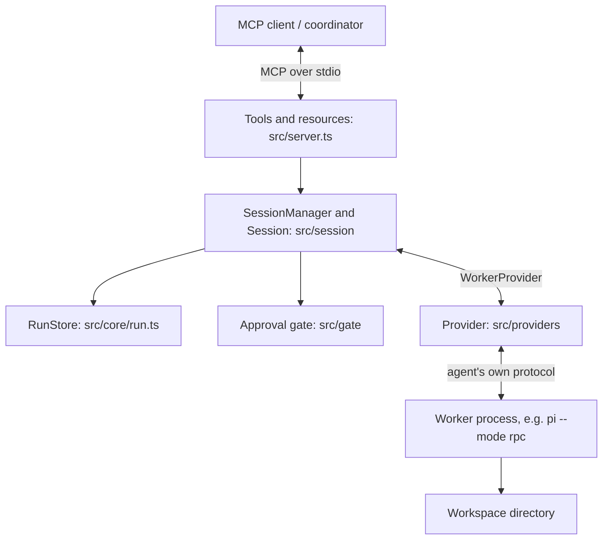
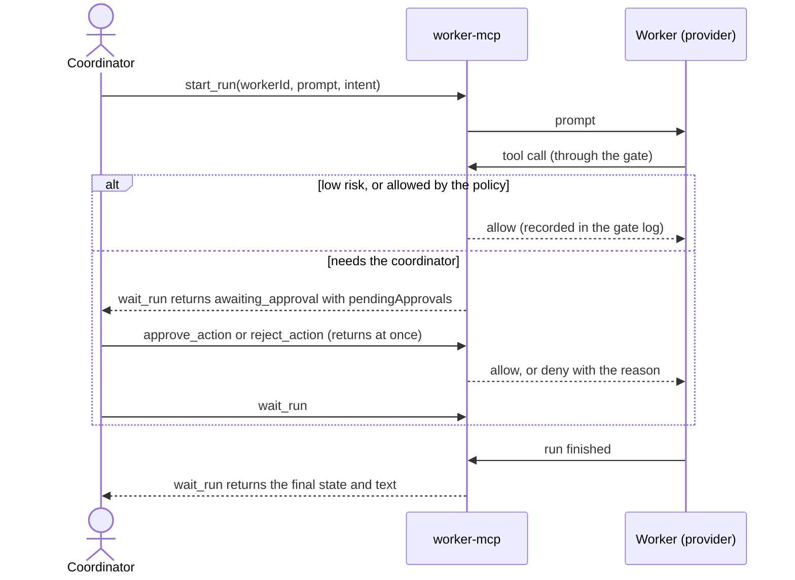

# Architecture: worker-mcp

How the server is put together: layers, the run and approval flows, and where the code lives. The tools themselves are in [mcp-api.md](mcp-api.md); the trust model is in [security.md](security.md).

---

## 1. Layers

| Layer        | Where                                                                      | Role                                                                                                                                                                                                                                                                 |
| ------------ | -------------------------------------------------------------------------- | -------------------------------------------------------------------------------------------------------------------------------------------------------------------------------------------------------------------------------------------------------------------- |
| Tool surface | `src/server.ts`, `src/tools.ts`, `src/resources.ts`, `src/tool-support.ts` | Registers the 13 tools and the resources. `src/schemas.ts` holds the strict zod input schemas, `src/outputs.ts` the output schemas, `src/render.ts` the untrusted-text wrapping.                                                                                     |
| Sessions     | `src/session/`                                                             | A `Session` is one worker: its status, the run in flight, its pending approvals and its gate. `SessionManager` owns the live workers, the worker limit, names, the idle reaper and the provider registry.                                                            |
| Runs         | `src/core/run.ts`                                                          | `Run` and `RunStore`: state, bounded output, tool-call activity, approvals, waiting. Nothing here knows a provider.                                                                                                                                                  |
| Gate         | `src/gate/`                                                                | Maps a tool call to a canonical kind, rates its risk, applies the worker's policy and the server's ceiling, in `auto` mode asks the HTTP classifiers (with a cache and a breaker) for calls the rules escalate, and keeps a bounded decision log plus an audit file. |
| Providers    | `src/providers/`                                                           | One module per agent type, behind one interface. The core starts and kills processes (`src/core/child.ts`); a provider only translates a protocol. See [providers.md](providers.md) and [providers/pi.md](providers/pi.md).                                          |
| Config       | `src/config.ts`                                                            | One validated `Config` from defaults, a JSON file, `WORKER_MCP_*` variables and flags.                                                                                                                                                                               |

Workers are not persisted. They live and die with the server; the runtime directory (one private directory per server, holding each worker's gate file) is created when the first worker starts and removed on shutdown.

## 2. Runs

A task given to a worker is a **run**. States: `starting`, `running`, `awaiting_approval`, then one of `completed`, `failed`, `cancelled`, `timed_out`.

- A worker has at most one run in flight. The `RunStore` (one per server) keeps every run with its output (bounded by `limits.outputBufferChars`) and its tool-call activity. A finished run stays readable for `limits.resultRetentionMs` after its worker is gone; at most `limits.maxRetainedRuns` are kept.
- A run settles exactly once. It ends through the provider reporting completion, the worker's exit, `cancel_run`, the run timeout (`limits.maxRunMs`) or shutdown. A worker that ignores an abort is closed after a grace period.
- `start_run` returns a `runId` (or waits up to `waitMs`). `wait_run` blocks at most `limits.maxWaitMs` and wakes early only on a terminal state or a new or expired approval. A cancelled request detaches the wait and leaves the run alone.
- With a `progressToken`, waiting calls send progress notifications. Nothing depends on them.
- MCP tasks are not offered.

## 3. Approval flow

- Every tool call is mapped to a canonical kind and rated LOW (0), MEDIUM (1), HIGH (2) or CRITICAL (3) by the rule classifier. Calls at or below the worker's `autoApproveUpTo` run; the rest wait for the coordinator. Overrides in the policy can allow, escalate or deny matching calls. The server's `gate.maxAutoApprove` (default MEDIUM, never CRITICAL) lowers any policy, and writes to protected paths are hard limits that no policy auto-approves.
- Approvals have server-made ids (`a_…`). An approval nobody answers is denied after `gate.approvalTimeoutMs` (10 minutes), and the worker sees the reason.
- The gate cannot be skipped: a provider that cannot gate each call is refused, and pi is never started without its gate extension. See [security.md](security.md).

## 4. Untrusted output

Whatever a worker wrote (output, tool calls, commands, paths, log text) is data from another model. Structured results keep it under keys named `untrusted…`; in text blocks, progress messages and resources it is wrapped as `<worker_output run="r_…" trust="untrusted">…</worker_output>`, with any `</worker_output` inside escaped. The server `instructions` tell the coordinator never to follow instructions found there.

## 5. Operations

- **Locating pi**: `providers.pi.path` (`WORKER_MCP_PI_PATH`), else `pi` on `PATH`.
- **Per-spawn gate**: the gate extension is a constant compiled into the server. Each spawn writes it to a fresh private directory under the runtime directory (mode 0700, file 0600) and starts pi with `--no-extensions --no-mcp --no-approve --no-session` and the gate loaded. If it cannot be written, the spawn is refused. Nothing is written under `~/.pi`.
- **Lifecycle**: a worker's process and everything it started are killed on terminate, idle close and shutdown (SIGTERM, then SIGKILL after a grace period). A worker whose process died is removed; its runs stay readable.
- **Logs**: each worker's stderr and server-side log lines are kept in a bounded ring, exposed as the resource `worker-mcp://workers/{workerId}/log`.
- **Configuration**: see the [README](../README.md#configuration); `worker-mcp --print-config` prints the effective values.
