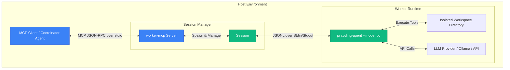
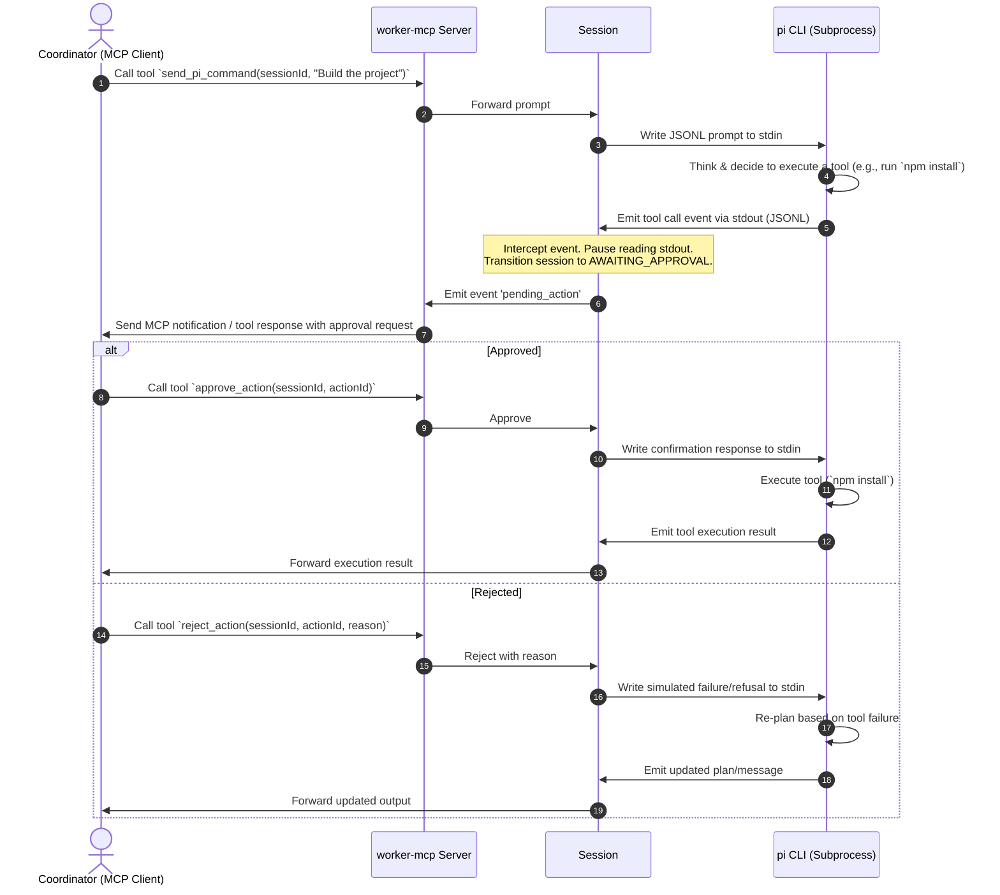

# Architecture & API Design: worker-mcp

This document details the software architecture, process interactions, and MCP tool/resource schemas for `worker-mcp`.

---

## 1. Component Architecture

The system consists of three layers:

### 1.1. Components

1. **MCP Client (Coordinator Agent)**: The orchestrator (e.g., Antigravity, Claude Desktop) that wants to delegate work but supervise the local execution.
2. **`worker-mcp` Server**: The MCP server that registers tools and resources, monitors child processes, and manages the interactive supervision loop.
3. **Session** (`src/session/session.ts`): A state wrapper in `worker-mcp` managing a single active worker session. It keeps track of command history, logs and pending approval states. It holds no protocol: the agent sits behind the provider interface (`src/providers/`), and its process is started and killed by `src/core/child.ts`. See [providers.md](providers.md).
4. **`pi` CLI Subprocess**: The globally/locally installed `@earendil-works/pi-coding-agent` executing in RPC mode (`pi --mode rpc`).
5. **LLM Provider**: The model runtime (e.g. Ollama for local LLMs, or cloud models via API) that the `pi` agent connects to.
6. **Workspace**: The specific local directory where the `pi` agent is executing commands and modifying files.

---

## 2. Interactive Supervision & Approval Flow

Because the local `pi` agent is less intelligent, we must gate high-risk actions (like bash commands or file modifications). `worker-mcp` uses a **smart gating system with risk levels** to automatically approve low-risk actions while requiring explicit coordinator approval for high-risk operations.

### 2.1. Risk Levels

| Level        | Value | Examples                                                        | Default Behavior            |
| ------------ | ----- | --------------------------------------------------------------- | --------------------------- |
| **LOW**      | `0`   | `ls`, `cat f \| grep x`, `git status`, reads in the workspace   | Auto-approve                |
| **MEDIUM**   | `1`   | file writes in the workspace, `git add`, reads outside it       | Require approval by default |
| **HIGH**     | `2`   | `rm`, `curl`, `pnpm install`, config file writes, unknown tools | Require explicit approval   |
| **CRITICAL** | `3`   | `sudo`, writes outside workspace, `git push --force`            | Require explicit approval   |

Tool calls are first mapped to canonical kinds (`src/gate/canonical.ts`) and rated by the rule classifier (`src/gate/rules.ts`, `src/gate/shell-rules.ts`). Writes to protected paths are hard limits that no policy can auto-approve. `src/gate/gate.ts` runs the classifier chain, applies the server's `gate.maxAutoApprove` ceiling to the worker's policy and records each decision in a bounded in-memory log. See [security.md](security.md).

Risk policy is configurable per session via `spawn_pi_session` (at creation) or `set_risk_policy` (at runtime). The default policy auto-approves LOW and requires approval for everything else. A policy is lowered to the ceiling (default MEDIUM) and the result says so.

### 2.2. Approval Flow

The following diagram describes how `worker-mcp` intercepts a tool execution, classifies its risk, and either auto-approves or asks the coordinator:

---

## 3. API Schema

### 3.1. MCP Tools

`worker-mcp` exposes the following tools to the coordinator:

#### `spawn_pi_session`

Creates and initializes a new `pi` agent session.

- **Arguments**:
  - `sessionId` (string, required): A unique identifier for the session.
  - `cwd` (string, required): The directory path where the `pi` agent will execute.
  - `model` (string, optional): LLM model name to override the default (e.g., `ollama/qwen2.5-coder:7b`, `anthropic/claude-3-5-sonnet`).
  - `systemPrompt` (string, optional): Custom system instructions to append or override.
  - `riskPolicy` (object, optional): Auto-approval policy; lowered to the server's `gate.maxAutoApprove` ceiling, and the result says what was lowered.
    - `autoApproveUpTo` (number): Calls at or below this risk level (0=LOW, 1=MEDIUM, 2=HIGH, 3=CRITICAL) are auto-approved. Default: `0` (LOW).
    - `overrides` (array, optional): Checked in order, the first match decides. Each entry has:
      - `match` (object, required): `kind`, `tool`, `command` and `path`; every field given must match. `tool`, `command` and `path` are globs where `*` matches any run of characters (in `command` it stops at shell metacharacters).
      - `action` (`"allow"`, `"escalate"` or `"deny"`, required): auto-approve, always ask, or refuse without asking.
      - `maxRiskLevel` (number, optional): For `allow`, the highest level it covers. Default `1` (MEDIUM).
    - The earlier shape (`notifyUpTo`, and overrides with `pattern`, `pathPattern` and `action: "allow" | "block"`) is still accepted and converted: `notifyUpTo` merges into `autoApproveUpTo`, `block` becomes `escalate`.
- **Returns**: `{ success: boolean, status: string }`

#### `send_pi_command`

Sends a prompt or slash command to a running session.

- **Arguments**:
  - `sessionId` (string, required): The ID of the target session.
  - `command` (string, required): The text prompt or slash command (e.g., `/model`, `/reload`, or a standard prompt).
  - `timeout` (number, optional): Maximum time in milliseconds to wait in blocking mode. If exceeded, returns with command still running. Environment variable `WORKER_MCP_COMMAND_TIMEOUT` provides a global default.
- **Returns**: `{ success: boolean, responseText: string }` (or starts streaming response if supported). Note: Supports MCP Tasks API (`execution.taskSupport: "optional"`). Task-aware clients receive a `CreateTaskResult` immediately and can poll via `tasks/get`. Non-task clients retain backward-compatible blocking behavior.

#### `cancel_pi_command`

Abort the currently running command in a session. Sends an abort signal to the pi agent; if it doesn't settle within 2 seconds, the process is force-terminated.

- **Arguments**:
  - `sessionId` (string, required): The ID of the session whose command to cancel.
- **Returns**: Confirmation message.

#### `terminate_pi_session`

Stops a session and removes it, freeing its id for reuse. Use this to clear sessions that have crashed, wedged, or are no longer needed.

- **Arguments**:
  - `sessionId` (string, required): The ID of the session to terminate.
- **Returns**: `{ success: boolean }`

#### `list_pi_sessions`

Lists all active sessions and their status.

- **Arguments**: None.
- **Returns**: An array of objects: `[{ sessionId: string, cwd: string, status: string, pendingAction: object | null }]`

#### `get_pending_actions`

Retrieves details of any action currently awaiting coordinator approval.

- **Arguments**:
  - `sessionId` (string, required): The target session ID.
- **Returns**: `{ sessionId: string, actionId: string, tool: string, arguments: object, context: string }`

#### `approve_action`

Approves a pending tool call.

- **Arguments**:
  - `sessionId` (string, required): The target session ID.
  - `actionId` (string, required): The ID of the intercepted tool call.
- **Returns**: `{ success: boolean }`

#### `reject_action`

Denies a pending tool call and sends a rejection/error message back to the worker agent.

- **Arguments**:
  - `sessionId` (string, required): The target session ID.
  - `actionId` (string, required): The ID of the intercepted tool call.
  - `reason` (string, optional): The reason for rejection (which will be fed back to the LLM to help it correct course).
- **Returns**: `{ success: boolean }`

#### `set_risk_policy`

Updates the risk-based auto-approval policy for a session at runtime.

- **Arguments**:
  - `sessionId` (string, required): The target session ID.
  - `riskPolicy` (object, required): The new risk policy (same schema as `spawn_pi_session.riskPolicy`).
- **Returns**: Summary of the applied policy.

#### `get_auto_approved_log`

Retrieves the audit log of actions that were auto-approved by the risk policy.

- **Arguments**:
  - `sessionId` (string, required): The target session ID.
- **Returns**: An array of auto-approved action records, each containing `actionId`, `toolName`, `input`, `riskLevel`, `riskLabel`, `reason`, and `timestamp`.

---

## 4. MCP Resources & Prompt Templates

### 4.1. Resources

- **`worker-mcp://sessions/{sessionId}/history`**: Exposes the complete JSON history of messages exchanged inside the `pi` session. Useful for the coordinator to review the exact chain of thought.
- **`worker-mcp://sessions/{sessionId}/logs`**: A real-time log of events, tool executions, and stdout streams from the spawned process.

### 4.2. Prompts (Templates)

- **`supervise-task`**: A prompt template for the coordinator agent explaining how to command the worker, monitor the progress, and audit tool execution safely.

---

## 5. Operational Design

### 5.1. Locating the Pi Executable

- By default, `worker-mcp` attempts to execute the `pi` binary from the system's `PATH`.
- The binary path can be explicitly overridden by setting the `WORKER_MCP_PI_PATH` environment variable (e.g., `WORKER_MCP_PI_PATH=/usr/local/bin/pi`).

### 5.2. Per-spawn Gating Extension

- The gate extension source is a constant compiled into the server. Before each worker spawn, `worker-mcp` writes it to a fresh private directory (`mkdtemp` under the server's private runtime directory `<runtimeDir>/worker-mcp-<pid>`, where `runtimeDir` defaults to `$XDG_RUNTIME_DIR`, or `<stateDir>/run` when that is unset; directory mode 0700, file mode 0600) and loads it with `-e`.
- pi is started with `--no-extensions --no-mcp --no-approve`, so it loads no discovered extensions, no MCP servers and no project-local files; only the gate runs.
- If the gate cannot be written, or the file is missing right before the spawn, the spawn is refused. pi is never started without the gate.
- The worker's directory is removed when the worker exits or is terminated, and the runtime directory when the server shuts down cleanly. At the next start, instance directories of pids that are no longer running are removed. Nothing is written under `~/.pi`.
- The gate sends structured JSON payloads (`{ toolName, input }`), enabling server-side risk classification.

### 5.3. No Persistence

- Workers are not persisted. They live and die with the server, and `sessions.json` is neither read nor written (an old file is ignored). `SessionManager` does no I/O when constructed; the runtime directory is created when the first worker starts.

### 5.4. Subprocess Lifecycle & Stderr Management

- **Stderr Capture**: Stderr is piped separately from stdout. All stderr output from the `pi` child process is buffered and appended directly to the session's log stream (`worker-mcp://sessions/{sessionId}/logs`) to aid debugging.
- **Crash Detection**: If the child process exits with a non-zero code without completing, the session state transitions to `Crashed`.
- **State Transition back to Idle**: When `pi` emits the `agent_settled` event on stdout, `worker-mcp` updates the session status from `Running Task` back to `Idle`, notifying the coordinator that it is ready for the next command.

### 5.5. Configuration

Settings come from a JSON file, `WORKER_MCP_*` environment variables and flags (in that order of precedence), are validated at startup with zod, and are passed down as one `Config` object (`src/config.ts`). The full table is in the [README](../README.md#configuration). `worker-mcp --print-config` prints the effective config.

----------------------------- | --------- | ------------------------------------------------------------------------- |
| `WORKER_MCP_PI_PATH` | `pi` | Path to the pi executable |
| `WORKER_MCP_ENV_PASSTHROUGH` | unset | Extra environment variable names for workers, see [security](security.md) |
| `WORKER_MCP_MAX_OUTPUT_CHARS` | `64000` | Maximum output characters before loop detection |
| `WORKER_MCP_COMMAND_TIMEOUT` | unset (∞) | Default timeout (ms) for blocking `send_pi_command` calls |

---

## 6. Async Execution Model

- The server advertises `tasks` capability with `list`, `cancel`, and `requests.tools.call` support
- Uses `InMemoryTaskStore` from the MCP SDK for task state management
- Task lifecycle: `working` → `completed` | `failed` | `cancelled`
- The `input_required` task status maps to the existing `AWAITING_APPROVAL` session state
- `send_pi_command` declares `execution.taskSupport: "optional"` for backward compatibility
- Non-task clients can use the `timeout` parameter for bounded blocking, and `cancel_pi_command` for cancellation
